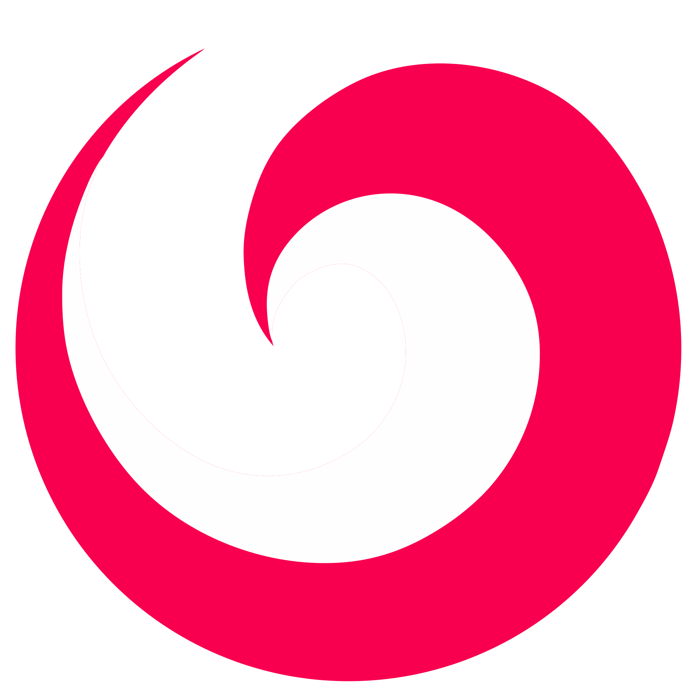

<p align="center">
  
</p>

<h1 align="center">Kyo</h1>

<p align="center">
  <i>o Noctalia com a minha cara</i>
</p>

<p align="center">
  
  
  
  
</p>

---

## Sobre

O Kyo é um fork do [Noctalia](https://github.com/noctalia-dev/noctalia), um shell nativo para Wayland que já traz
barra, dock, launcher, central de controle, notificações, lock screen e widgets num pacote só.

Eu mexi **só no visual**: troquei o nome e o logo e criei paletas de cores novas. Por baixo é o Noctalia de sempre,
sem funcionalidade nova e sem mudança de arquitetura. Todo o mérito do trabalho de verdade é do pessoal do projeto
original.

## Por que isso existe?

Esse repositório **não é um projeto sério**. Eu uso Debian e queria um lugar meu, num repositório meu, de onde eu
pudesse baixar e instalar o shell do jeito que eu gosto, sem precisar refazer tudo a cada instalação. Se ele servir
pra mais alguém, ótimo, mas foi feito pensando em mim.

## Paletas

Todas têm versão escura e clara. A **Kyo** é a padrão. Abaixo, as cores da versão escura (primária, secundária,
terciária e erro):

| Paleta        | Primária | Secundária | Terciária | Erro |
| ------------- | :------: | :--------: | :-------: | :--: |
| **Kyo**       |  |  |  |  |
| **Butterfly** |  |  |  |  |
| **Yagami**    |  |  |  |  |
| **Cyberpunk** |  |  |  |  |

- **Kyo:** rosa forte sobre cinza escuro.
- **Butterfly:** violeta suave, com rosa e azul claro.
- **Yagami:** roxo escuro com ciano e amarelo neon.
- **Cyberpunk:** vermelho, ciano e roxo sobre um fundo arroxeado.

Nas paletas novas a cor de erro é sempre vermelha. As paletas do Noctalia (Ayu, Catppuccin, Dracula, Eldritch,
Gruvbox, Kanagawa, Nord, Rosé Pine e Tokyo-Night) continuam disponíveis. Os detalhes técnicos das mudanças estão em
[MUDANCAS-KYO.md](MUDANCAS-KYO.md).

## Instalação

> **Nota:** a instalação "oficial" deste projeto é feita por um **script separado, que mora em outro repositório
> meu**: [`Noctalia-Install-Debian`](https://github.com/kitsuioky/Noctalia-Install-Debian.git). Ele é pensado pro Debian e
> pergunta se você quer instalar o **Kyo** (este repositório) ou o **Noctalia original**. Ele é a forma recomendada
> de instalar, mas o script não faz parte deste repositório.

Se preferir compilar na mão, clone o repositório e use o `just`. As dependências estão na seção
[Contribuindo e dependências](#contribuindo-e-dependências-debian):

```sh
git clone https://github.com/kitsuioky/kyo.git
cd kyo

just configure release   # configura o build
just build release       # compila
sudo just install release
```

Para instalar na sua home, sem sudo, passe um prefixo: `just configure release "$HOME/.local"`.
Para remover: `sudo just uninstall release`.

Depois é só iniciar com o comando `kyo`. Você também precisa de um compositor Wayland rodando (Sway, Niri,
Hyprland...). Sem gerenciador de login, dá pra iniciar o compositor direto do TTY.

### Trocando o Noctalia pelo Kyo

O Kyo instala o binário `kyo` e usa `~/.config/kyo`, então não sobrescreve nada do Noctalia. Mas os dois não devem
rodar juntos:

1. Pare o Noctalia.
2. No config do seu compositor, troque o comando que inicia o Noctalia por `kyo`.
3. Se quiser, desinstale o Noctalia do mesmo jeito que você instalou.

A configuração antiga não é migrada, então o Kyo começa com um `~/.config/kyo` limpo.

### Greeter

O Kyo não instala nem compila nenhum greeter. Se existir um `kyo-greeter` em `/usr/bin` ou `/usr/local/bin`, ele
sincroniza a aparência com ele. Sem greeter, tudo funciona normalmente.

## Contribuindo e dependências (Debian)

Contribuição é bem-vinda, mas lembre que é um projeto pessoal e eu respondo quando der. Pra compilar na mão no
Debian, estas são as dependências:

```sh
sudo apt install meson g++ just \
  libwayland-dev wayland-protocols \
  libegl-dev libgles-dev \
  libfreetype-dev libfontconfig-dev \
  libcairo2-dev libpango1.0-dev libharfbuzz-dev \
  libxkbcommon-dev libglib2.0-dev \
  libsecret-1-dev libsodium-dev \
  libsdbus-c++-dev libpipewire-0.3-dev libwireplumber-0.5-dev \
  libpam0g-dev libpolkit-agent-1-dev libpolkit-gobject-1-dev \
  libcurl4-openssl-dev libwebp-dev libjxl-dev libsndfile1-dev librsvg2-dev \
  libqalculate-dev libxml2-dev \
  libmd4c-dev libtomlplusplus-dev libical-dev \
  nlohmann-json3-dev libstb-dev \
  libjemalloc-dev
```

Pra rodar, é bom ter também (nenhum é obrigatório pra compilar):

```sh
sudo apt install pipewire wireplumber gnome-keyring upower sway
```

Os comandos de compilação estão na seção [Instalação](#instalação).

Pontos de atenção:

- O código é **C++23**, então precisa de GCC 13+ ou Clang 16+. O **Debian 13 (trixie)** já traz isso. No Debian 12
  o compilador padrão é velho demais, veja a nota no [BUILDING.md](BUILDING.md).
- As bibliotecas Luau, Wuffs e fzy já vêm junto no repositório, não precisa instalar.
- Sem aceleração 3D (por exemplo, numa VM sem virgl), o Kyo cai em renderização por software e pode ficar lento.
- Detalhes de arquitetura e estilo de código estão no [CONTRIBUTING.md](CONTRIBUTING.md) e no
  [ARCHITECTURE.md](ARCHITECTURE.md), que vêm do projeto original.

## Avisos

- É um **fork não oficial**, sem nenhuma ligação com o Noctalia ou com os mantenedores dele.
- **Não ofereço suporte.** Pode ser que não funcione no seu sistema, e não prometo responder issues ou dúvidas.
- **Não garanto manter o projeto.** Vou tentar o máximo, mas ele pode ficar parado ou defasado em relação ao Noctalia.
- Tudo é fornecido **"como está"**, sem garantia, nos termos da licença MIT. Use por sua conta e risco.
- Se o problema não tem a ver com o visual do Kyo, o lugar certo é o projeto original.

## Créditos

Quem fez o trabalho pesado foi o projeto **[Noctalia](https://github.com/noctalia-dev/noctalia)** e os
contribuidores dele. O Kyo é só uma camada visual por cima. As bibliotecas e recursos usados estão no
[CREDITS.md](CREDITS.md).

## Licença

MIT. Veja o [LICENSE](LICENSE). O aviso de copyright original do Noctalia foi mantido, como a licença exige.
